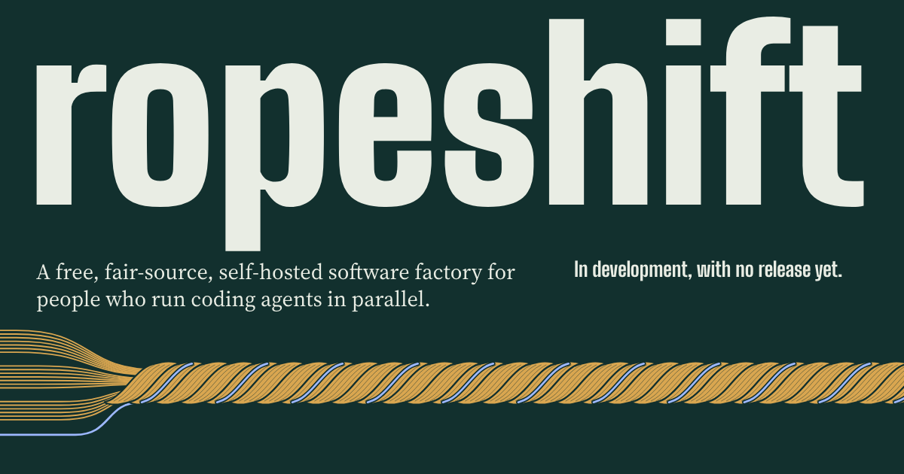
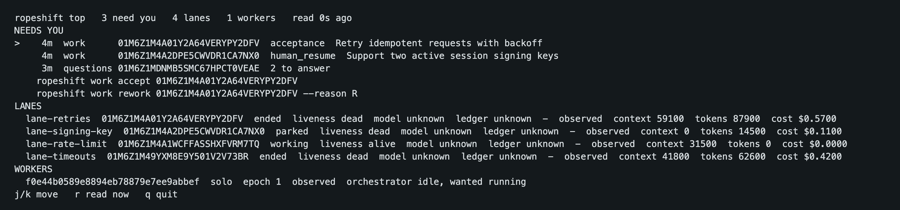

# ropeshift

[](https://github.com/bkuberek/ropeshift/actions/workflows/ci.yml)
[](https://github.com/bkuberek/ropeshift/actions/workflows/release.yml)
[](https://github.com/bkuberek/ropeshift/releases)
[](https://github.com/bkuberek/homebrew-tap)
[](go.mod)
[](docs/onboarding.md)
[](LICENSE.md)
[](https://github.com/bkuberek/ropeshift/commits/main)

Ropeshift is a free, fair-source, self-hosted software factory: project management combined with agentic workforce management and operations. It turns planned work into verified outcomes with supervised agents, and it is designed to interrupt a person only when a person is needed. It wraps agent CLIs: this release drives Claude Code, and drivers for Codex and opencode are part of the design. It does not replace them, and it is not a model client.

Website: [ropeshift.com](https://ropeshift.com/)

## Status

Alpha. Solo mode works: one machine, macOS or Linux, with the Claude Code CLI as the agent runtime, a local ledger, the web UI, and the `top` terminal view. Install a pre-release with `brew install bkuberek/tap/ropeshift` or the install script, then follow [docs/onboarding.md](docs/onboarding.md). Expect breaking changes before 1.0.0. The group and cluster modes described below are the design and are not built yet.

## Install

Releases cover macOS and Linux on arm64 and amd64. Every channel installs one binary, `ropeshift`, with `ropeshiftd` as a link to it and the web UI built in.

Install with Homebrew:

```sh
brew install bkuberek/tap/ropeshift
```

Homebrew may ask you to trust the tap first. If it does, run `brew trust bkuberek/tap` once.

Or install with the install script:

```sh
curl -fsSL https://raw.githubusercontent.com/bkuberek/ropeshift/main/install.sh | sh
```

With no `--version`, the script installs the newest stable release, or the newest pre-release while no release is stable, and says which it chose. It checks the archive's SHA-256 against the release's checksums file before it extracts anything, and installs to `~/.local/bin`. Options go after `sh -s --`:

```sh
curl -fsSL https://raw.githubusercontent.com/bkuberek/ropeshift/main/install.sh | sh -s -- --version v0.1.0-alpha.2 --prefix /usr/local
```

On Debian, Ubuntu, Fedora, or RHEL, download the `.deb` or `.rpm` package for your architecture from the [releases page](https://github.com/bkuberek/ropeshift/releases), and install it with `sudo dpkg -i` or `sudo rpm -i`.

`go install` is not an install channel for now: install from a release.

Ropeshift also needs git, tmux for lanes in a terminal pane, and the Claude Code CLI installed and signed in. Then follow [Onboarding](docs/onboarding.md). [Releasing](docs/releasing.md#install-channels) lists every channel.

## Screenshots

These are the web UI of `v0.1.0-alpha.2` and `ropeshift top`, running locally with sample data. The web UI follows the system's light or dark setting.

Needs you puts what waits for a person first, oldest first: work to accept, work its lane could not finish, a parked lane, and questions an orchestrator could not settle, with its recommendation marked.


Decisions lists what members and orchestrators decided or assumed, with the question each answers and what it cites.


The shop floor shows each worker and each lane, with its state, liveness, and generation.


Operations shows the fleet mode, its limits, and how many work orders and lanes are in each state, followed by the sources and the product measures.


`ropeshift top` watches the same fleet from a terminal.



## What it is

Ropeshift has four parts. Each is built for solo mode in this release:

| Part | What it provides in this release |
|------|----------------------------------|
| Work ledger | The system of record for execution, in a local SQLite ledger per project: claims, leases, outcomes, questions, decisions, and evidence. One installation holds many isolated projects, and a project can span several repositories. Work comes from repository files or is recorded directly, so ropeshift works with no tracker at all |
| Planning and decisions | A planning session with one agent that turns your answers into requirements, documents, milestones, contracts, and work orders, approved as one plan whose branch then lands at the merge authority level you choose; `ropeshift adopt` to bring an existing project in; a contract review that finds questions before work starts; and a searchable record of every decision and its rationale |
| Supervised agents | One orchestrator per machine pulls work and exercises judgment. A deterministic daemon keeps each Claude Code session healthy, and a fence stops a holder that lost its claim from writing. Every session can hand work to an agent roster you edit with `ropeshift agent`, each lane runs as the agent its work needs, and the costly agents ask first. A review agent checks each finished change against its contract and gives every criterion a verdict. Accepted work lands at the merge authority level you choose: you merge it, ropeshift merges it after your approval, or ropeshift merges it after the review's approval with every required check green, always at the reviewed commit, through a GitHub pull request with your own `gh` sign-in or into the base branch with git, and every approval and merge is recorded |
| Web UI | Needs you across every project; the roadmap with each milestone's work by dependency layer, plans and their versions, plan approval with the groups of an adopted plan, the planning pane beside the plan a session is writing, documents with their requirements traced to criteria, work, and verdicts, decisions, and open questions; work orders, the floor of lanes, and measures; each project's repositories, agent roster, settings, and audit; and the installation's projects, workers, members, and usage. Projects are created, imported from a backup upload, backed up as a download, and adopted from an existing folder of clones there, served on loopback, with `ropeshift top` beside it in a terminal |

These parts of the design are not built yet: reading work from an issue tracker and writing results back to it, workers on more than one machine, and drivers for Codex and opencode.

## How work flows

1. Work arrives from repository files or directly in the ledger. Reading it from a tracker is part of the design.
2. A person or a planning agent writes a plan and its contracts.
3. Contract review collects every question it can find, in one batch. Work becomes `ready` only when it passes a definition of ready.
4. An orchestrator claims ready work and starts a lane: one writer in one worktree.
5. When a lane has a question, it climbs a ladder: existing decisions, open questions, a decision within policy, a recorded assumption, and only then a person.
6. A lane that truly cannot proceed parks. It saves its work, stops its process so it uses no quota, and resumes when the answer arrives.
7. The lane ends with a typed outcome, artifacts, and check results, and a member accepts the work or sends it back for rework. Writing the result back to a tracker is part of the design.

The north-star metric is human interruptions per completed work order. `ropeshift measures` prints it beside the measures that keep it honest.

## Ways to run it

Team size changes configuration, not concepts, and every mode is designed to use the same versioned API. Solo mode is the one built in this release:

| Mode | How it runs | Store | Status |
|------|-------------|-------|--------|
| Solo | One binary on one machine, with no Docker, no account, and no network requirement | SQLite | Built |
| Self-hosted group | Docker Compose on a LAN or tailnet, with workers that dial out, so laptops open no inbound ports | Postgres | Design, not built yet |
| Cluster | A Helm chart and Terraform modules in your own cloud | Postgres | Design, not built yet |

## Agent sign-in

Each agent CLI is installed and signed in on each worker, through its vendor's own flow. Ropeshift never reads, stores, relays, or proxies agent credentials. A worker that uses a subscription is bound to the person who signed in, and shared workers use API keys.

## Claude subscription accounts

Ropeshift runs the unmodified `claude` binary that you installed and signed in to, so a lane can run on your Claude subscription. It is an independent project, and it is not affiliated with or endorsed by Anthropic, OpenAI, or any other vendor.

Anthropic's [Consumer Terms](https://www.anthropic.com/legal/consumer-terms) restrict automated use of subscription accounts, and its [usage limits assume ordinary, individual usage](https://code.claude.com/docs/en/legal-and-compliance). Running the unmodified binary does not by itself resolve that, and autonomous operation moves further from ordinary use. Running automated sessions carries account risk that you accept.

A subscription worker starts at `attended`, where it claims work only inside a run window a person opened, and goes further only after a member acknowledges the stated risk for that worker. No vendor has approved this use. [Onboarding](docs/onboarding.md#claude-subscriptions-and-automated-use) states the risk in full.

## Documentation

- [Vision](docs/vision.md): the problem, the principles, and the non-goals.
- [Onboarding](docs/onboarding.md): installing a release, from an empty machine to a first lane, and what to know before it runs.
- [Command line](docs/cli.md): every command, the daemon's flags, and the exit codes.
- [API](docs/api.md): the routes of the installation and of each project.
- [Authorization](docs/authorization.md): who may approve what, and the limit of same-user isolation.
- [Qualification](docs/qualification.md): how each Claude Code version is checked before ropeshift relies on it.
- [Notifications](docs/notifications.md): what a notice says, and where it goes.
- [Telemetry](docs/telemetry.md): what is recorded, where it stays, and when it leaves the machine.
- [Product measures](docs/measures.md): the north star and how each measure is computed.
- [Versioning](docs/versioning.md): how versions are chosen, and what `ropeshift version` reports.
- [Releasing](docs/releasing.md): how a release is built, tested, and published, each install channel, and how branches relate to stability.

## License and contributions

Ropeshift is fair source under the [Functional Source License](https://fsl.software/), FSL-1.1-ALv2. See [LICENSE.md](LICENSE.md). Each version also becomes available under Apache-2.0 two years after its release. Outside code contributions are not open yet.
